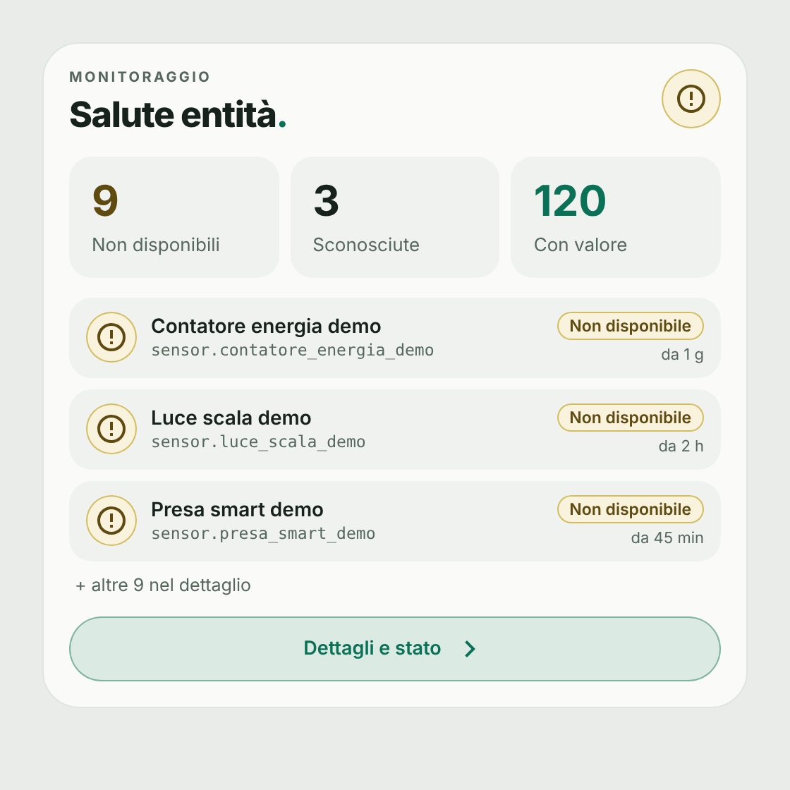
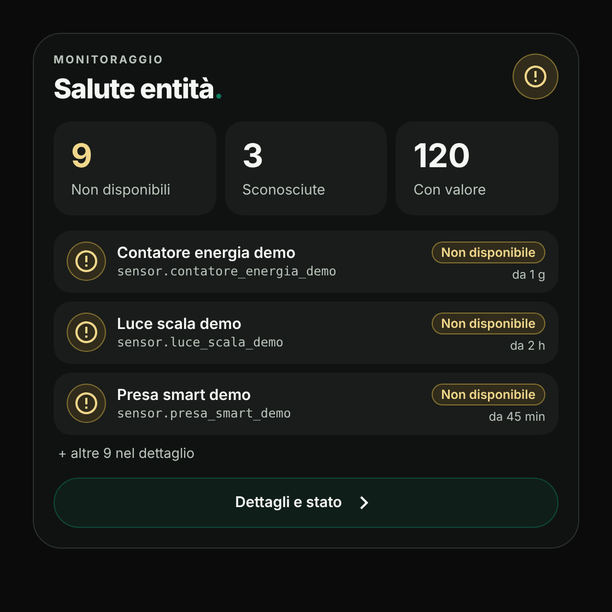
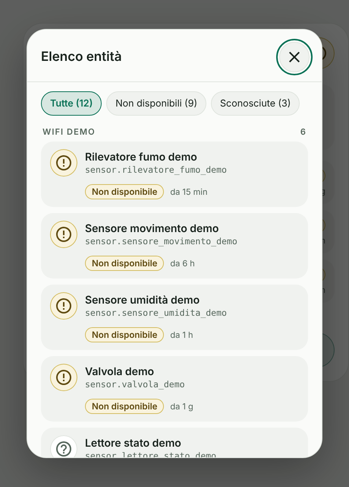

# Entity Health Card

[](https://www.tiktok.com/@luigi.regolo)
[](LICENSE)
[](https://my.home-assistant.io/redirect/hacs_repository/?owner=luigi-regolo&repository=entity-health-card&category=plugin)
[](https://github.com/luigi-regolo/entity-health-card/stargazers)

## Overview

**Entity Health Card** is a read-only dashboard card for Home Assistant that lists the entities currently reported as `unavailable` or `unknown`, designed with a minimalist interface inspired by the Edera Light and Dark visual styles.

It shows at a glance how many entities cannot be read, which ones they are, and how long they have been in that state. It never sends commands to your devices.

The card only uses the entity states already available in Home Assistant. It does not require a dedicated account, external services or additional libraries.

## Preview







*Previews use fictional demo data. The interface text is currently in Italian.*

## Features

- **Summary tiles:** Unavailable, unknown and healthy entity counts.
- **Problem list:** The most recent problem entities, with name, entity ID, status and time since the last state change. The number of visible rows is configurable (1–10).
- **Details popup:** Opens from the **Dettagli e stato** button, or by clicking an entity, which opens the popup positioned on that entity. Includes filters by status and grouping by integration (falls back to the entity domain when the integration is not available).
- **Two monitoring modes:** Monitor all entities, or only a selected list.
- **Exclusions:** Domains excluded by default (`update`, `button`, `scene`); hidden entities are skipped unless enabled.
- **Careful wording:** An entity shown as "Non disponibile" cannot be read by Home Assistant; this does not necessarily mean the device is off. Unknown states are never shown as healthy.
- **Visual configuration:** Configure the card through the Home Assistant dashboard editor, without writing YAML.
- **Edera appearance:** Automatic, Light and Dark themes with Home Assistant Material Design Icons.
- **Responsive layout:** A responsive interface for desktop, smartphone and tablet dashboards.

## Installation

### HACS — Custom repository

[](https://my.home-assistant.io/redirect/hacs_repository/?owner=luigi-regolo&repository=entity-health-card&category=plugin)

1. Open **HACS** in Home Assistant.
2. Open the menu and select **Custom repositories**.
3. Enter the repository URL:

   `https://github.com/luigi-regolo/entity-health-card`

4. Select **Dashboard** as the repository type and add it.
5. Find **Entity Health Card** in HACS and download it.
6. Reload the Home Assistant dashboard if necessary.
7. Add the card using the visual editor.

The repository contains `hacs.json` and the distributable JavaScript module `dist/entity-health-card.js`.

### Manual installation

1. Download `dist/entity-health-card.js` from the GitHub repository.
2. Copy it to the `www` directory of your Home Assistant configuration as `entity-health-card.js`.
3. Open **Settings → Dashboards → Resources** in Home Assistant.
4. Add the following resource:

   `/local/entity-health-card.js`

5. Select **JavaScript module** as the resource type.
6. Reload the dashboard and add the card.

If the `www` directory was just created, Home Assistant may need to be restarted before the file becomes accessible.

## Configuration and Usage

### Visual editor

Open a dashboard in edit mode, add **Entity Health Card** and configure it. The editor has three sections:

- **Entità:** monitoring mode and entity selection.
- **Aspetto:** title, header label and theme.
- **Avanzate:** excluded domains, hidden entities and display options.

### Example YAML configuration

The card can be configured entirely through the visual editor. The following example uses fictional entity identifiers:

```yaml
type: custom:entity-health-card
title: Salute entità
mode: manual
entities:
  - sensor.temperatura_demo
  - switch.presa_demo
max_rows: 4
```

### Main configuration options

| Option | Description |
|---|---|
| `title` | Main card title. |
| `eyebrow` | Small header label above the title. |
| `theme_mode` | `auto`, `light` or `dark`. |
| `mode` | `all` (all entities) or `manual` (selected entities only). |
| `entities` | Entities to monitor when `mode` is `manual`. |
| `exclude_domains` | Domains ignored in `all` mode. Default: `update`, `button`, `scene`. |
| `include_hidden` | Include entities hidden in Home Assistant. Default: `false`. |
| `show_unavailable` | Report unavailable entities. Default: `true`. |
| `show_unknown` | Report unknown entities. Default: `true`. At least one of the two is always active. |
| `max_rows` | Entities shown on the card, from 1 to 10. Default: `4`. |
| `show_entity_id` | Show the entity ID under the name. Default: `true`. |
| `group_details` | Group the popup list by integration. Default: `true`. |

## Compatibility and Requirements

- Home Assistant with support for custom JavaScript dashboard modules.
- No additional libraries, subscriptions or cloud services.

No specific minimum Home Assistant version has been independently verified or declared for this repository.

## Privacy and Security

The card is read-only: it never calls services or sends commands. It uses only the entity states and permissions already available in Home Assistant, and it contains no telemetry, analytics, remote scripts or external assets.

## Copyright & License

Copyright © 2026 luigi-regolo.

Original project created and maintained by **luigi-regolo**.

Licensed under the **GNU General Public License version 3 only (GPL-3.0-only)**.

See the [LICENSE](LICENSE) file for the complete license terms.

The software is provided without warranty to the extent permitted by applicable law.
